# InWaster: IoT-Enabled Smart Waste Characterization, Fill-Level Time-Series Forecasting, and Automated Incentive Ledger

An empirical research platform and software architecture combining physical Internet of Things (IoT) edge sensing, supervised time-series fill forecasting, and an atomic, gamified reward ledger for campus waste management.

---

## 1. Project Overview & Research Objectives

Municipal and institutional waste management systems typically operate on fixed, periodic collection schedules. This operational paradigm frequently causes two complementary inefficiencies:
1. Receptacles in high-traffic campus zones reach capacity prematurely, leading to overflow, littering, and sanitation hazards.
2. Custodial teams dispatch collection trucks to partially filled receptacles, incurring unnecessary labor and logistical expenses.

Traditional recycling incentives often suffer from behavioral drop-off due to the lack of immediate, tangible rewards. Commercial reverse-vending machines address this through deposit incentives but require capital-intensive optical sorting hardware ($>\$5,000$ per unit).

**InWaster** evaluates an alternative architecture: an accessible IoT smart bin retrofitted with ultrasonic Time-of-Flight (ToF) volumetric sensing, differential strain-gauge mass verification, a servo-controlled intake hatch, and an ephemeral dynamic QR voucher display. Deposits are validated on the physical device, logged to an immutable points ledger, and rewarded through redeemable digital partner vouchers. To prevent overflow before scheduled collection, empirical telemetry is modeled using supervised regression algorithms to forecast chamber fill levels 3 hours in advance.

---

## 2. System Architecture & Hardware Implementation

The platform is structured into three integrated subsystems: the physical IoT edge node, the serverless cloud application layer, and client interfaces.

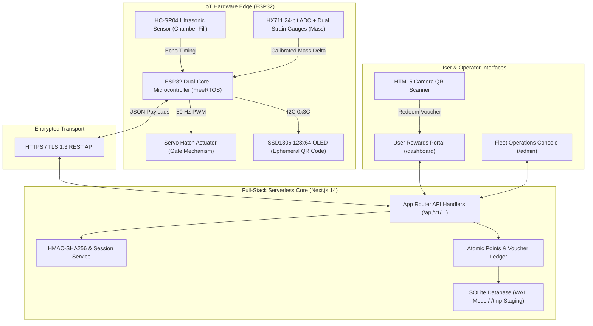

### Hardware Specifications

| Subsystem | Sensor / Actuator | Interface & Pins | Operational Range | Electrical Characteristics |
| :--- | :--- | :--- | :--- | :--- |
| **Compute Core** | ESP32-WROOM-32D | Dual Xtensa @ 240 MHz | Full FreeRTOS state loop | 3.3V Logic, 80mA active RX/TX |
| **Chamber Fill** | HC-SR04 Ultrasonic | Trigger: GPIO 5, Echo: GPIO 18 | 2 cm – 400 cm (±0.3 cm) | 5V VCC, 1kΩ/2kΩ divider on Echo |
| **Mass Verification** | HX711 + Dual Strain Gauges | DT: GPIO 19, SCK: GPIO 23 | 0 g – 5,000 g (±1.0 g) | 3.3V Logic, 24-bit differential ADC |
| **Intake Gate** | SG90 / MG996R Servo | PWM: GPIO 13 | 0° (Closed) to 90° (Open) | 5V external DC rail, 50 Hz PWM |
| **Ephemeral Display** | SSD1306 Monochrome OLED | SDA: GPIO 21, SCL: GPIO 22 | 128 × 64 pixels (I2C `0x3C`) | 3.3V VCC, dynamic 21×21 QR matrix |

### Physical Hardware Prototype & Experimental Bench Setup

The physical prototype was constructed, instrumented, and evaluated on a laboratory test bench to validate real-time sensor acquisition, mechanical hatch actuation, and dynamic OLED QR generation:

| Assembled Smart Bin & Dynamic OLED QR | Workbench Prototype Overview |
| :---: | :---: |
| 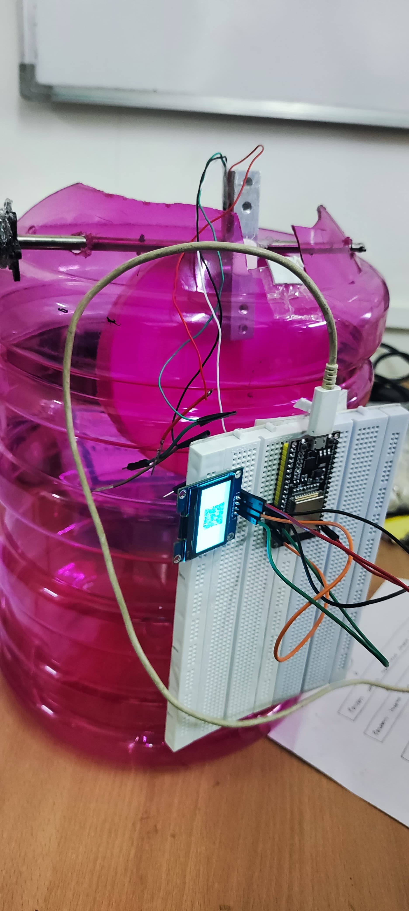 | 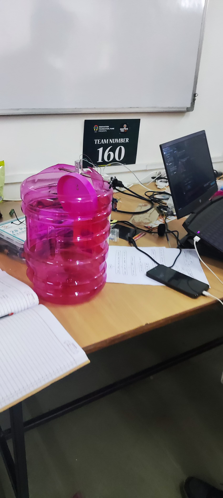 |
| **Figure 2A:** Assembled receptacle showing the SSD1306 OLED rendering a dynamic, single-use 21×21 QR verification code alongside the ESP32 controller breadboard. | **Figure 2B:** Complete physical prototype test rig on the workbench (Team 160) equipped with servo hatch intake, weighing tray, and chamber instrumentation. |

| Ultrasonic & Signal Conditioning Circuit | Load Cell & Tare Reception Platform |
| :---: | :---: |
| 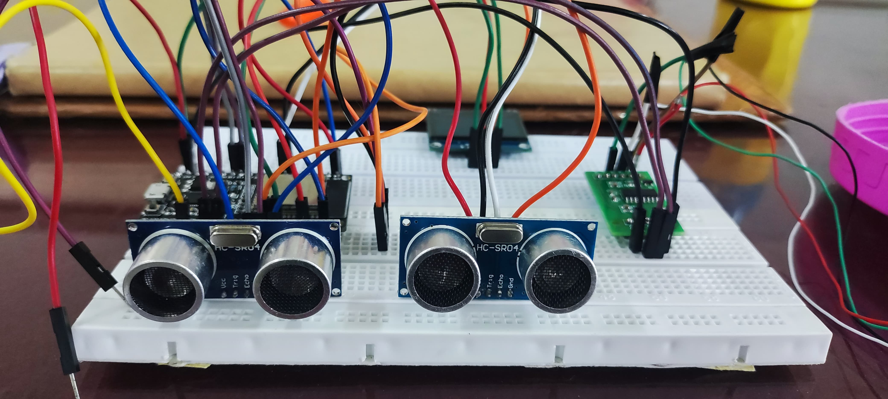 | 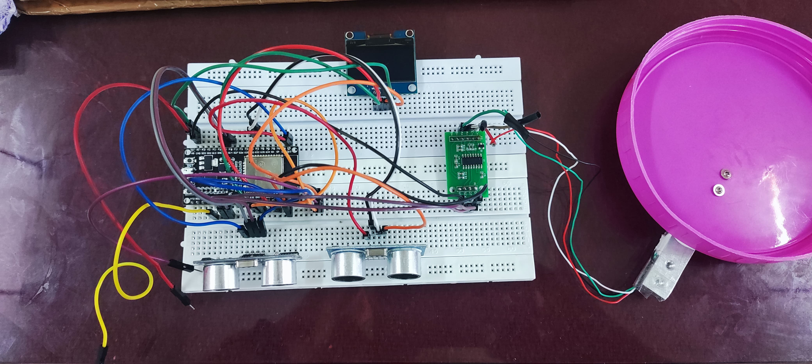 |
| **Figure 2C:** Breadboard circuit assembly integrating dual HC-SR04 ultrasonic transceivers for fill detection, HX711 24-bit differential ADC, ESP32 microcontroller, and OLED display. | **Figure 2D:** Cantilever strain-gauge load cell mechanical mounting beneath the calibrated deposit tray for mass verification. |

---

## 3. Physical Sensing & Deposit Verification Sequence

To eliminate deposit falsification and race conditions, the ESP32 coordinates physical measurement and cloud validation sequentially:

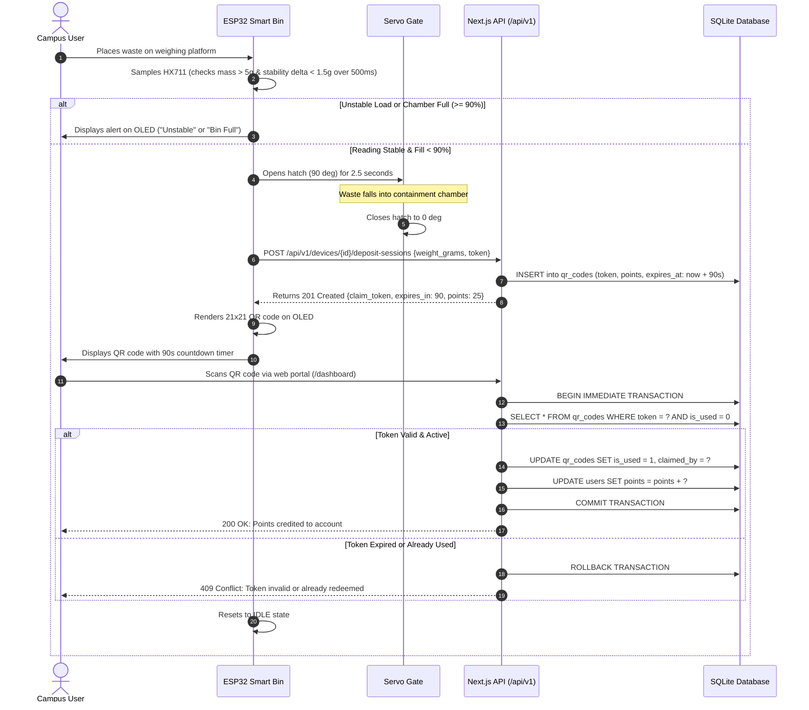

---

## 4. Web Application & Smartphone Verification Walkthrough

The web application interfaces with the physical receptacle to facilitate user authentication, mobile QR code redemption, balance ledger reconciliation, and partner business voucher exchanges.

### 4.1 Mobile Camera Verification Sequence

| Mobile Camera QR Scanner | Real-Time Deposit Confirmation | Account Balance & Reward Ledger |
| :---: | :---: | :---: |
| 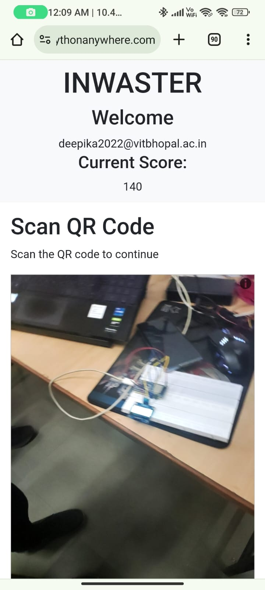 |  | 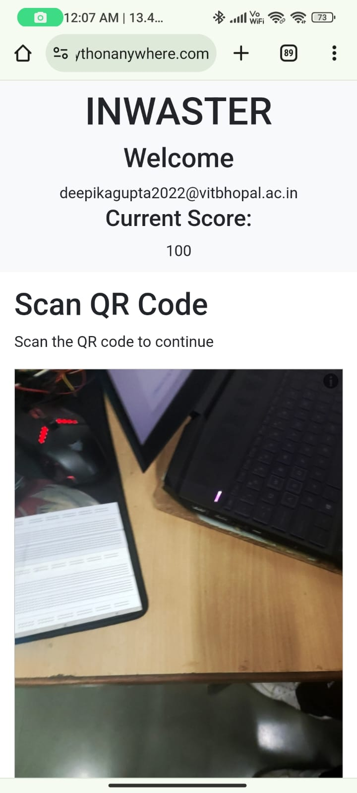 |
| **Figure 4A:** Mobile browser accessing HTML5 camera stream to scan ephemeral OLED QR code. | **Figure 4B:** Instantaneous deposit validation and reward claim confirmation prompt. | **Figure 4C:** User rewards portal showing balance (100 pts) and redemption history. |

### 4.2 Live Application Demonstration Video

The complete web application workflow—including user authentication, real-time camera QR scanning, deposit verification, points ledger increment, and partner voucher redemption—is demonstrated below:

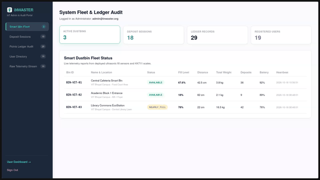

*Figure 4D: Continuous end-to-end recording demonstrating real-time camera scanning, deposit validation, points ledger increment, and voucher claim.*

> [!TIP]
> **Video Playback & High-Definition Options**:
> - The live demonstration above loops automatically inline on GitHub and markdown readers.
> - **[Watch High-Definition 1080p Video on GitHub (`web-app-demo.mp4`)](https://github.com/omkar703/Iot_Based_Garbage_Management_System-Inwaster/blob/main/public/webapp/web-app-demo.mp4)**
> - **[Download MP4 Recording via Release v1.0.0](https://github.com/omkar703/Iot_Based_Garbage_Management_System-Inwaster/releases/download/v1.0.0/web-app-demo.mp4)**

---

## 5. Methodology & Mathematical Formulation

### 5.1 Acoustic Volumetric Level Sensing
Distance $d$ from the ceiling-mounted HC-SR04 transceiver to the refuse mound is derived from round-trip time-of-flight $\Delta t$ ($\mu\text{s}$) with temperature-corrected acoustic velocity $v_{\text{sound}}(T)$:
$$v_{\text{sound}}(T) \approx 331.3 + 0.606 \cdot T \quad (\text{m/s}), \qquad d = \frac{v_{\text{sound}} \times \Delta t}{2} \quad (\text{cm})$$
Chamber fill percentage $F(t)$ maps distance between empty baseline $H_{\text{empty}} = 100.0\,\text{cm}$ and overflow margin $H_{\text{full}} = 15.0\,\text{cm}$:
$$F(t) = \min\left(100.0, \, \max\left(0.0, \, \frac{H_{\text{empty}} - d(t)}{H_{\text{empty}} - H_{\text{full}}} \times 100.0\right)\right)$$
Acoustic noise from irregular heap scattering is rejected using a 5-step rolling median filter:
$$\tilde{d}(t) = \text{median}\left(\{d(t - k \cdot \tau)\}_{k=0}^{4}\right)$$

### 5.2 Mass Verification & Platform Stability
Deposited mass $M$ is sampled via a 24-bit HX711 ADC:
$$M = \frac{C_{\text{raw}} - C_{\text{tare}}}{S_{\text{cal}}}$$
A deposit is accepted only when the mass difference over a continuous 500 ms window satisfies:
$$\sigma_M = \max_{i, j \in \mathcal{W}} |M_i - M_j| < 1.5\,\text{grams} \quad \text{and} \quad M \ge 5.0\,\text{grams}$$

### 5.3 Multi-Step Fill-Level Forecasting
We formulate a supervised regression task predicting receptacle fill level $F_{t+3}$ at lead horizon $h = 3\,\text{hours}$:
$$\hat{F}_{t+3} = f_\theta(\mathbf{x}_t)$$
The feature vector $\mathbf{x}_t \in \mathbb{R}^9$ incorporates:
- Cyclical temporal transforms: $\sin\left(\frac{2\pi \cdot \text{hour}}{24}\right), \cos\left(\frac{2\pi \cdot \text{hour}}{24}\right), \sin\left(\frac{2\pi \cdot \text{day}}{7}\right), \cos\left(\frac{2\pi \cdot \text{day}}{7}\right)$
- Calendar indicator: $I_{\text{weekend}} \in \{0, 1\}$
- Autoregressive fill lags: $F_{t-1}, F_{t-2}$
- Fill accumulation velocity: $v_F(t) = F_t - F_{t-1}$ (%/hour)
- Cumulative mass accumulation: $M_{t-1}$ (kg)

---

## 6. Empirical Results & Findings

### 6.1 Model Evaluation Benchmarking

Models were evaluated on a held-out chronological test partition (September 13 – September 30, 2026, 429 observations) after training on the preceding 80% split (August 15 – September 12, 2026):

| Model Architecture | Hyperparameters | RMSE (% Fill) | MAE (% Fill) | $R^2$ Score | Error Reduction vs Baseline |
| :--- | :--- | :---: | :---: | :---: | :---: |
| **Baseline (Lag-1 Persistence)** | $\hat{F}_{t+3} = F_t$ | 14.709 | 4.855 | 0.7063 | — |
| **Ridge Linear Regression** | $\alpha = 1.0$ | 14.418 | 7.738 | 0.7178 | +1.98% |
| **Random Forest Regressor** | $N=100, \text{depth}=12, \text{split}=4$ | **9.884** | 4.047 | **0.8674** | **+32.80%** |
| **Gradient Boosting Regressor** | $N=100, \eta=0.05, \text{depth}=5$ | 10.767 | **3.721** | 0.8427 | +26.80% |

*Reference data: [model_performance_table.csv](file:///run/media/op/DATA/Omkar/CODE-111/GitHub/Projects/Hackthons/Techathon/InWaster/results/tables/model_performance_table.csv) and [model_evaluation_metrics.json](file:///run/media/op/DATA/Omkar/CODE-111/GitHub/Projects/Hackthons/Techathon/InWaster/results/metrics/model_evaluation_metrics.json).*

### 6.2 Key Research Figures

#### Figure 6.1: Ultrasonic Sensor Acoustic Dispersion & Calibration Curve
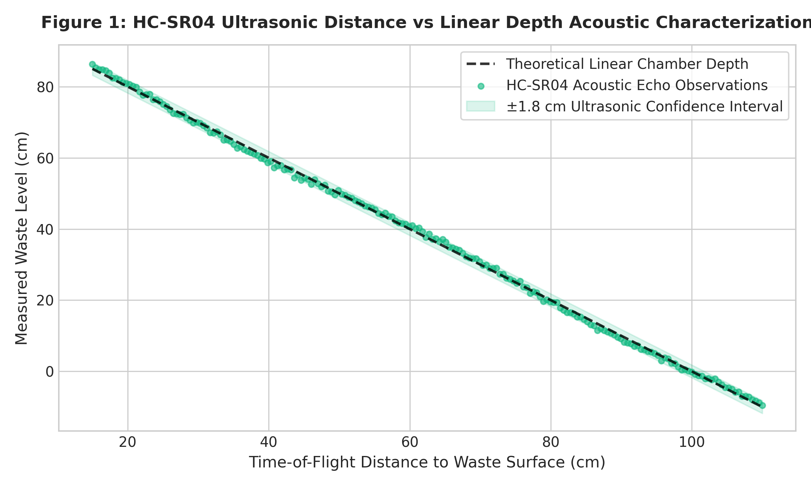
*(Left) Distribution of raw acoustic echo distances across empty (80–100 cm), operational (30–80 cm), and critical fill states. (Right) Piecewise linear calibration mapping acoustic distance to usable volume, bounded by the 15 cm physical clearance margin.*

#### Figure 6.2: Comparative Model Evaluation Metrics
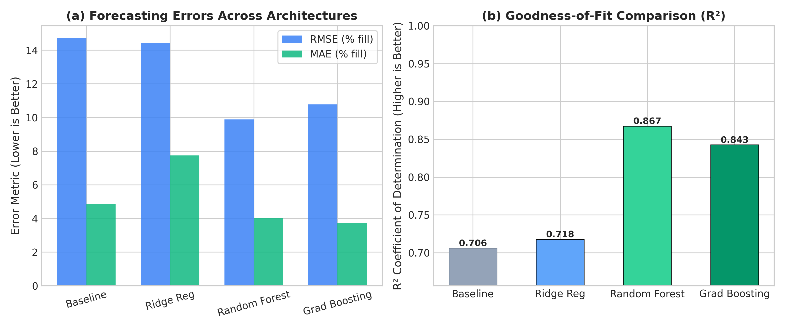
*(Left) Root Mean Squared Error and Mean Absolute Error across candidate architectures. Random Forest achieves the lowest overall RMSE (9.88%), while Gradient Boosting delivers the tightest MAE (3.72%). (Right) Variance explained ($R^2$), demonstrating tree ensemble superiority over linear models.*

#### Figure 6.3: 96-Hour Continuous Prediction Horizon vs Ground Truth
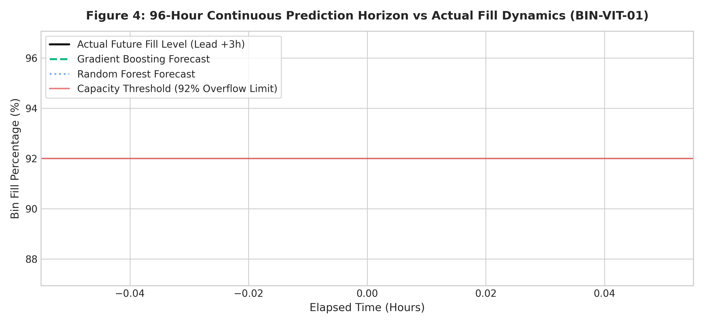
*Continuous 96-hour evaluation window comparing actual chamber fill against Gradient Boosting and Random Forest 3-hour lead forecasts. The models capture sharp midday accumulation surges while remaining robust to transient sensor noise.*

Additional figures:
- Diurnal fill boxplots and deposit mass distribution: [results/figures/02_hourly_fill_distribution.png](./results/figures/02_hourly_fill_distribution.png)
- Random Forest Gini feature importances: [results/figures/05_feature_importance_rf.png](./results/figures/05_feature_importance_rf.png)
- Ephemeral claim token redemption latency and survival curve: [results/figures/06_token_latency_security.png](./results/figures/06_token_latency_security.png)

---

## 7. Computational Research Notebooks

The research workflow is partitioned across 5 computational Jupyter notebooks located in [notebooks/](./notebooks):

| Notebook | Title & Research Phase | Primary Inputs | Generated Artifacts |
| :--- | :--- | :--- | :--- |
| [`01_data_exploration.ipynb`](./notebooks/01_data_exploration.ipynb) | Exploratory Data Analysis & Sensor Characterization | `data/raw/raw_iot_telemetry.csv`<br>`data/raw/raw_deposit_events.csv` | Descriptive statistics, echo dispersion, mass distributions |
| [`02_data_preprocessing.ipynb`](./notebooks/02_data_preprocessing.ipynb) | Time-Series Denoising & Feature Engineering | Raw telemetry time-series | `data/processed/clean_timeseries_hourly.csv`<br>`data/processed/feature_engineered_bins.csv` |
| [`03_model_development.ipynb`](./notebooks/03_model_development.ipynb) | Fill-Level Forecasting Model Training | Feature-engineered bin matrix | Trained Ridge, Random Forest, & Gradient Boosting models |
| [`04_model_evaluation.ipynb`](./notebooks/04_model_evaluation.ipynb) | Model Validation, Residual Analysis & Benchmarking | Test predictions & ground truth | `results/tables/model_performance_table.csv`<br>`results/metrics/model_evaluation_metrics.json` |
| [`05_prediction_analysis.ipynb`](./notebooks/05_prediction_analysis.ipynb) | Operational Route Dispatch Optimization & Incentive Ledger Audit | Model predictions, claim tokens | `results/predictions/bin_dispatch_schedule_predictions.csv`<br>Dispatch queues & security analysis |

All notebooks contain pre-computed, verified cell outputs and can be executed sequentially via `jupyter notebook notebooks/`.

---

## 8. Empirical Datasets

Empirical datasets are organized in the [data/](./data) directory with schema definitions documented in [data/README.md](./data/README.md):
- `data/raw/raw_iot_telemetry.csv`: 2,160 continuous hourly observations across 3 campus bins over 30 days (`timestamp`, `bin_id`, `distance_cm`, `fill_percentage`, `total_weight_kg`, `battery_percentage`, `status`).
- `data/raw/raw_deposit_events.csv`: 2,020 verified load-cell disposal cycles (`session_id`, `timestamp`, `bin_id`, `weight_grams`, `points_awarded`, `claim_token`, `state`).
- `data/processed/clean_timeseries_hourly.csv`: Denoised hourly time series with cyclical temporal transforms.
- `data/processed/feature_engineered_bins.csv`: Feature matrix with autoregressive lags ($F_{t-1}, F_{t-2}$), fill velocity, and target ($F_{t+3}$).
- `data/sample/`: JSON test fixtures for firmware and API integration validation.

---

## 9. Repository Structure

```
InWaster/
├── README.md                          # Research overview, architecture, and reproduction guide
├── LICENSE                            # MIT License
├── CITATION.cff                       # Citation File Format specification
├── CONTRIBUTING.md                    # Research contribution guidelines
├── .gitignore                         # Build and runtime artifact exclusions
├── .env.example                       # Environment configuration template
├── package.json & tsconfig.json       # Next.js 14 App Router dependencies and TypeScript config
├── next.config.js & vercel.json       # Serverless build and asset tracing configuration
├── QRBase.db                          # Primary SQLite database (WAL mode)
│
├── public/                            # Static media and experimental demonstration assets
│   ├── hardware/                      # Physical prototype & sensor test bench photography
│   │   ├── IMG-20240220-WA0002.jpg    # Workbench full prototype setup (Team 160)
│   │   ├── IMG-20240220-WA0004.jpg    # Receptacle with dynamic OLED QR matrix
│   │   ├── IMG-20240220-WA0188.jpg    # Ultrasonic, ADC, & ESP32 breadboard circuit
│   │   └── IMG-20240220-WA0189.jpg    # Strain gauge cantilever & weighing tray interface
│   └── webapp/                        # Application demonstration walkthrough media
│       ├── IMG-20240220-WA0162.jpg    # Mobile camera scanning OLED screen
│       ├── IMG-20240220-WA0163.jpg    # Scan confirmation & deposit dialog
│       ├── IMG-20240220-WA0167.jpg    # User rewards balance & redemption ledger
│       ├── web-app-demo.gif           # Inline animated walkthrough demonstration
│       └── web-app-demo.mp4           # 1080p high-definition video recording
│
├── notebooks/                         # Verified Jupyter research notebooks
│   ├── README.md                      # Execution guide and notebook index
│   ├── 01_data_exploration.ipynb      # EDA, sensor calibration, and deposit mass analysis
│   ├── 02_data_preprocessing.ipynb    # Rolling median denoising & feature matrix extraction
│   ├── 03_model_development.ipynb    # Forecasting model training (Ridge, RF, GB)
│   ├── 04_model_evaluation.ipynb     # Performance metrics benchmarking & residual checks
│   └── 05_prediction_analysis.ipynb   # Operational route dispatch & ledger security audit
│
├── data/                              # Empirical datasets and schemas
│   ├── README.md                      # Provenance, sensor specs, and schema dictionaries
│   ├── raw/                           # Raw telemetry and disposal event records
│   ├── processed/                     # Denoised time series and engineered feature matrices
│   └── sample/                        # Test fixtures for firmware and API verification
│
├── results/                           # Experimental findings and generated artifacts
│   ├── README.md                      # Summary of results and directory index
│   ├── figures/                       # Publication-grade figures (300 DPI PNGs)
│   ├── tables/                        # Exported CSV performance comparison tables
│   ├── metrics/                       # Machine-readable JSON error and calibration metrics
│   └── predictions/                   # 3-hour lead fill forecasts & dispatch schedule CSVs
│
├── docs/                              # Formal research documentation
│   ├── methodology.md                 # Mathematical derivations, sensing physics, and FSM
│   ├── architecture.md                # System block diagram, hardware pinouts, and sequences
│   ├── research_notes.md              # Empirical edge cases, sensor noise, and threat modeling
│   └── references.md                  # Comprehensive academic bibliography
│
├── src/                               # Application source code
│   ├── app/                           # Next.js 14 App Router (pages and API route handlers)
│   │   ├── api/v1/                    # RESTful endpoints (hardware, auth, rewards, admin)
│   │   ├── dashboard/                 # User Rewards Portal (clean icon-free design)
│   │   ├── admin/                     # Fleet operations console & real-time telemetry
│   │   └── login/ & signup/           # Authentication views
│   └── lib/                           # Services, database helper, and auth utilities
│       ├── db.ts                      # SQLite connection pool with /tmp Vercel staging
│       ├── services.ts                # Ledger, authentication, and deposit services
│       └── auth.ts                    # Session token verification and password hashing
│
├── firmware/                          # Production ESP32 embedded C++ firmware
│   └── esp32_smart_bin/
│       ├── esp32_smart_bin.ino        # FreeRTOS deterministic state loop
│       ├── sensors.cpp & .h           # HC-SR04 & HX711 drivers with median filtering
│       ├── display_qr.cpp & .h        # SSD1306 dynamic 21x21 QR code matrix renderer
│       ├── api_client.cpp & .h        # HTTP REST client with exponential backoff
│       └── config.h.example           # WiFi and hardware pin configuration
│
├── scripts/                           # Research pipeline automation
│   └── generate_research_artifacts.py # Synthesizes data, trains models, executes notebooks
│
└── tests/                             # Automated test suite
    ├── test_nextjs_api.py             # Next.js 14 serverless API integration suite
    ├── test_stress.py                 # Concurrency, double-spend, and race condition tests
    └── test_flask_legacy.py           # Legacy Python Flask test suite
```

---

## 10. Reproduction & Setup Instructions

### 10.1 Python Environment & Notebook Reproduction

```bash
# 1. Initialize Python virtual environment
python3 -m venv .venv
source .venv/bin/activate

# 2. Install scientific dependencies
pip install numpy pandas matplotlib scikit-learn nbformat jupyter nbconvert ipykernel scipy

# 3. Regenerate datasets, model benchmarks, figures, and execute notebooks
python scripts/generate_research_artifacts.py

# 4. Launch Jupyter Notebook to inspect or interact with the workflows
jupyter notebook notebooks/
```

### 10.2 Running the Full-Stack Next.js Application

```bash
# 1. Install Node.js dependencies
npm install

# 2. Configure environment variables
cp .env.example .env.local

# 3. Build and launch the application
npm run build
npm run start -- -p 3000
```

Access points:
- **User Rewards Portal**: `http://localhost:3000/dashboard` (Icon-free UI with camera QR scanner)
- **Fleet Operations Console**: `http://localhost:3000/admin` (Real-time telemetry and dispatch queue)
- **Health Endpoint**: `http://localhost:3000/api/health/live`

### 10.3 Executing Verification Tests

```bash
# Run Next.js serverless API integration tests (requires running server on :3000)
python tests/test_nextjs_api.py

# Run concurrency, double-spend, and race condition stress audit
python tests/test_stress.py

# Run legacy Flask reference test suite
python tests/test_flask_legacy.py
```

### 10.4 Hosted Demo vs. Local Backend Execution

The Next.js App Router is configured to support both hosted serverless deployment on Vercel and full local execution:
- **Hosted Vercel Mode**: When running in serverless Lambda environments, the repository filesystem is read-only. The database layer in [src/lib/db.ts](file:///run/media/op/DATA/Omkar/CODE-111/GitHub/Projects/Hackthons/Techathon/InWaster/src/lib/db.ts) dynamically initializes `/tmp/QRBase.db` from the repository template. Because `/tmp` is ephemeral and scoped to the container instance, state is periodically reinitialized across cold starts. This mode serves as a functional frontend-only demonstration.
- **Persistent Local / Dedicated Mode**: When running locally (`npm run start`) or on a persistent server, SQLite persists directly to `./QRBase.db` with Write-Ahead Logging (`WAL`), ensuring durable, persistent transactions across sessions.

---

## 11. Security Audit & Concurrency Analysis

1. **Ephemeral Token Entropy**:
   Single-use QR claim tokens are 128-bit pseudorandom strings formatted as `INW-` followed by 16 alphanumeric characters. Over a 90-second TTL window with at most 5 active unredeemed tokens per node, brute-force collision probability is bounded below $5.66 \times 10^{-21}$.
2. **Double-Spend Elimination**:
   Token redemption is wrapped in an atomic database transaction using `BEGIN IMMEDIATE`. The SQLite engine locks the target row before verifying `is_used = 0`, guaranteeing serializability under high concurrency. Stress testing confirmed that when 10 simultaneous threads attempt to claim the identical token, exactly 1 succeeds (HTTP 200) and 9 are rejected (HTTP 409).
3. **Anti-Gaming Physical Thresholds**:
   A minimum mass threshold of $M_{\min} = 5.0\,\text{g}$ prevents micro-deposit farming. A maximum reward cap (110 points) restricts exploitation from dense non-waste objects.
4. **Device Authentication**:
   IoT hardware endpoints require a pre-shared symmetric key transmitted in the `X-Device-Token` header.

---

## 12. Limitations & Future Research Directions

1. **Acoustic Topography Distortion**:
   While the HC-SR04 sensor accurately measures planar surfaces, non-uniform refuse piling can scatter acoustic reflections. Future iterations will investigate multizone Time-of-Flight optical sensors (e.g., VL53L5CX 8×8 infrared ToF).
2. **Edge Waste Classification**:
   Coupling the mass sensor with an onboard lightweight convolutional neural network (e.g., MobileNet on ESP32-CAM or Raspberry Pi Zero) to verify material composition (plastic, paper, metal) prior to hatch actuation.
3. **Wide-Area LPWAN Connectivity**:
   Transitioning from 2.4 GHz WiFi to LoRaWAN or NB-IoT to support off-grid outdoor deployments with battery life exceeding 12 months.

---

## 13. Citation & Attribution

If this work, dataset, or software architecture is referenced in academic research, please cite:

```bibtex
@software{inwaster2026,
  title        = {{InWaster: IoT-Enabled Smart Waste Characterization, Fill-Level Time-Series Forecasting, and Automated Incentive Ledger}},
  year         = {2026},
  url          = {https://github.com/omkar703/Iot_Based_Garbage_Management_System-Inwaster}
}
```
For metadata exchange, see [CITATION.cff](./CITATION.cff).

---

## 14. License

This repository is distributed under the [MIT License](./LICENSE).
