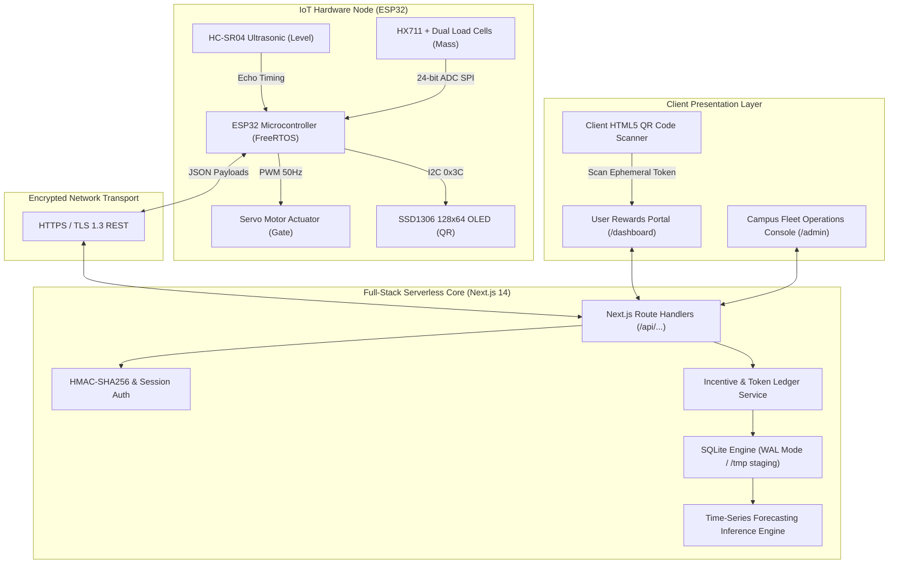
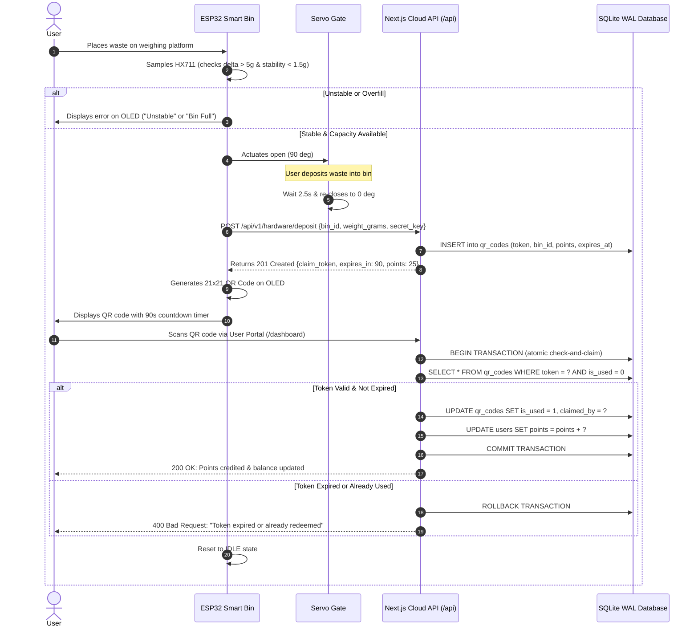

# InWaster System Architecture & Engineering Specifications

---

## 1. System Block Diagram & Tiered Architecture

The InWaster platform is architected across three cohesive tiers: **Physical Sensing & Actuation Node (IoT Edge)**, **Application & Ingestion Serverless Layer (Next.js 14)**, and **Client Presentation & Verification Interface**.



---

## 2. Hardware Subsystem Specifications

| Subsystem | Component | Bus / Protocol | Electrical Interface | Purpose |
| :--- | :--- | :--- | :--- | :--- |
| **Microcontroller** | ESP32-WROOM-32D | Dual-Core Tensilica Xtensa LX6 @ 240MHz | 3.3V Logic | Orchestrates state machine, sensor sampling, WiFi, and actuation |
| **Volumetric Sensing**| HC-SR04 Ultrasonic | GPIO Trigger (Pin 5) / Echo (Pin 18) | 5V VCC with 1k/2k voltage divider on Echo | Measures chamber head-space distance (2cm - 400cm, ±0.3cm resolution) |
| **Mass Verification** | HX711 + Strain Gauges | Serial 2-Wire (DT Pin 19, SCK Pin 23) | 3.3V Logic | 24-bit delta-sigma differential ADC measuring deposited mass (0g - 5000g) |
| **Mechanical Hatch** | SG90 / MG996R Servo | PWM @ 50Hz (Pin 13) | 5V External DC Rail | Mechanical gate actuation (0° Closed, 90° Open, 2.5s cycle) |
| **Ephemeral Display** | SSD1306 OLED (128x64) | I2C (SDA Pin 21, SCL Pin 22) | 3.3V VCC, address `0x3C` | Renders dynamic QR matrix and countdown timer for reward redemption |

---

## 3. IoT-to-Cloud Communication & Incentive Sequence

The end-to-end lifecycle ensures non-repudiation and single-use claim guarantees:



---

## 4. Next.js 14 Serverless & Database Architecture

### 4.1 Serverless Filesystem Dynamics
On standard persistent servers (e.g. Linux VPS), SQLite persists directly to `./QRBase.db`. When deployed on Vercel's stateless serverless infrastructure:
1. The root repository directory is strictly read-only (`EROFS` error on write).
2. The runtime environment dynamically initializes `/tmp/QRBase.db` from the repository template if not already present.
3. Write-Ahead Logging (`WAL`) mode is enabled with busy timeout set to $5000\,\text{ms}$ to ensure zero locks during concurrent read/write transactions.

### 4.2 Endpoint Hierarchy
All endpoints adhere to RESTful principles and standardized JSON envelopes:

```
/
├── /dashboard              # User Rewards Portal (QR scan, balance, coupons)
├── /admin                  # Operations Console (fleet telemetry, logs, dispatch)
├── /login & /signup        # Session authentication
└── /api/
    ├── /v1/auth/           # User authentication, registration, session validation
    ├── /v1/hardware/
    │   ├── /status         # Periodic bin telemetry heartbeat (fill, mass, battery)
    │   └── /deposit        # Authenticated deposit cycle submission & QR minting
    ├── /v1/rewards/
    │   ├── /claim          # Ephemeral QR token redemption handler
    │   └── /redeem         # Partner coupon redemption & balance deduction
    ├── /receivemsg         # Backward-compatible IoT telemetry ingestion webhook
    ├── /processQR          # Backward-compatible QR redemption webhook
    └── /adminlogs          # Administrative audit trail retrieval
```

---

## 5. Security & Fault Tolerance Measures

1. **Hardware Node Authentication**:
   Every IoT payload transmits an SHA-256 preshared authentication token in the `X-Device-Token` header. Unauthenticated device traffic is rejected with HTTP 401.
2. **Ephemeral QR Lifespan**:
   QR claim tokens carry a hard 90-second expiration timestamp. Tokens cannot be screen-captured and redeemed asynchronously.
3. **Double-Spend Prevention**:
   Token redemption is wrapped in an atomic SQLite database transaction (`BEGIN IMMEDIATE`). A row-level check verifies `is_used = 0` before incrementing user point balances and updating token status.
4. **Mechanical Jam Protection**:
   The servo hatch utilizes a non-blocking timeout. If mechanical obstruction occurs, the actuator aborts and triggers an operational alert.
