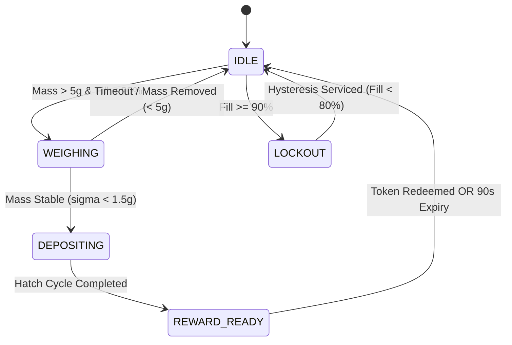

# InWaster Research Methodology: Sensing Physics, State Automata, and Fill-Level Forecasting

---

## 1. Physical Sensing Principles & Signal Processing

### 1.1 Acoustic Time-of-Flight (TOF) Volumetric Level Detection
The smart bin measures chamber fill level using an ultrasonic acoustic transceiver (HC-SR04) mounted coaxially at the chamber ceiling pointing vertically downward towards the waste repository base.

#### Speed of Sound Formulation
The acoustic velocity in dry ambient air varies with ambient temperature $T$ ($^\circ\text{C}$):
$$v_{\text{sound}}(T) = 331.3 \cdot \sqrt{1 + \frac{T}{273.15}} \approx 331.3 + 0.606 \cdot T \quad (\text{m/s})$$
At standard room temperature ($T = 20^\circ\text{C}$), $v_{\text{sound}} \approx 343.42\,\text{m/s} = 0.034342\,\text{cm/\mu s}$.

#### Two-Way Travel Distance
Given the elapsed round-trip time-of-flight $\Delta t$ ($\mu\text{s}$):
$$d = \frac{v_{\text{sound}} \times \Delta t}{2} = \frac{0.034342 \times \Delta t}{2} \quad (\text{cm})$$

#### Chamber Geometry & Capacity Utilization Transformation
Let $H_{\text{empty}}$ denote the internal acoustic distance when the bin is empty ($100.0\,\text{cm}$), and $H_{\text{full}}$ denote the clearance margin to prevent chamber jamming ($15.0\,\text{cm}$). The linear capacity utilization percentage $F(t)$ is defined as:
$$F(t) = \min\left(100.0, \, \max\left(0.0, \, \frac{H_{\text{empty}} - d(t)}{H_{\text{empty}} - H_{\text{full}}} \times 100.0\right)\right)$$

#### Acoustic Noise Denoising via Rolling Median Filter
To eliminate spurious reflections from uneven refuse mounds, airborne dust, or transient mechanical vibrations, raw echo times are filtered across a sliding window of $N=5$ consecutive pings:
$$\tilde{d}(t) = \text{median}\left(\{d(t - k \cdot \tau)\}_{k=0}^{N-1}\right)$$

```
Acoustic Chamber Calibration:
  +-----------------------------------+  <-- HC-SR04 Sensor (Ceiling, d = 0 cm)
  |            Clearance (15 cm)      |  <-- Overflow Cutoff (H_full = 15 cm -> 100% Fill)
  | . . . . . . . . . . . . . . . . . |
  |                                   |
  |      Effective Volume (85 cm)     |
  |                                   |
  | ~~~~~~~~~~~~~~~~~~~~~~~~~~~~~~~~~ |  <-- Top Surface of Refuse (Echo Distance d)
  | ################################# |
  | ################################# |  <-- Deposited Waste
  +-----------------------------------+  <-- Chamber Floor (H_empty = 100 cm -> 0% Fill)
```

---

### 1.2 Piezoresistive Strain-Gauge Load Cell Integration
Mass measurement utilizes a dual 5kg parallel strain-gauge load cell arrangement connected via Wheatstone bridge to a 24-bit differential ADC (HX711).

#### Calibration & Tare Equation
The digital ADC output code $C_{\text{raw}}$ is converted to calibrated mass $M$ (grams):
$$M = \frac{C_{\text{raw}} - C_{\text{tare}}}{S_{\text{cal}}}$$
where $C_{\text{tare}}$ is the tare offset captured upon boot when the platform is unloaded, and $S_{\text{cal}}$ is the empirical sensitivity constant (counts/gram).

#### Platform Stability Criterion
Prior to opening the servo intake hatch or issuing an incentive token, the system validates reading stability. A measurement sequence is declared stable if the absolute difference over a continuous sampling interval $\Delta \tau = 500\,\text{ms}$ satisfies:
$$\sigma_M = \max_{i, j \in \mathcal{W}} |M_i - M_j| < \epsilon_{\text{stable}} = 1.5\,\text{grams}, \quad \text{where } \mathcal{W} = \{t \in [t_0, t_0 + 500\,\text{ms}]\}$$
Deposits failing this stability criterion (e.g. erratic manual tampering or wind gusts) are rejected with status `UNSTABLE_LOAD`.

---

## 2. Finite State Machine (FSM) Automata

The ESP32 firmware coordinates physical actuation and cloud telemetry via a deterministic finite state machine with 5 discrete operational states:

| State | Entry Condition | Invariant / Monitoring | Exit Trigger | Next State |
| :--- | :--- | :--- | :--- | :--- |
| **`IDLE`** | Initialization complete or previous session finalized | Ultrasonic ping every 2s; load cell idle monitoring | Waste detected on platform ($M > 5\text{g}$) AND $F < 90\%$ | `WEIGHING` |
| **`WEIGHING`** | Net positive mass on intake tray | Stability window verification ($\sigma_M < 1.5\text{g}$) | Mass stabilized ($M \ge 5\text{g}$) | `DEPOSITING` |
| **`DEPOSITING`** | Stable mass confirmed | Servo gate actuates to $90^\circ$ for $2.5\text{s}$, drops waste, returns to $0^\circ$ | Gate fully re-closed and confirmed | `REWARD_READY` |
| **`REWARD_READY`**| Deposit dropped into internal chamber | Single-use token generated; OLED displays QR; countdown timer | Token claimed by user OR 90s timeout expires | `IDLE` |
| **`LOCKOUT`** | Ultrasonic fill level $F \ge 90\%$ | Chamber full banner on OLED; servo mechanically locked | Bin emptied ($F < 80\%$ with hysteresis) | `IDLE` |



---

## 3. Incentive Ledger Formulation

Reward points awarded per validated deposition event adhere to a monotonic step-wise linear piecewise utility function:
$$P(M) = 
\begin{cases} 
0, & \text{if } M < M_{\min} = 5\,\text{grams} \\
P_{\text{base}} + \left\lfloor \frac{M}{M_{\text{step}}} \right\rfloor, & \text{if } 5\,\text{g} \le M \le M_{\max} \\
P_{\max}, & \text{if } M > M_{\max} = 5000\,\text{grams}
\end{cases}$$
where:
- $P_{\text{base}} = 10\,\text{points}$ (Participation incentive)
- $M_{\text{step}} = 50\,\text{grams}$ (Marginal incentive step)
- $P_{\max} = 110\,\text{points}$ (Anti-gaming rate cap)

---

## 4. Supervised Multi-Step Fill-Level Forecasting

### 4.1 Problem Formulation
Let $\mathbf{x}_t \in \mathbb{R}^D$ represent the feature vector observed at discrete hour $t$. The objective is to forecast the future chamber fill level $F_{t+h}$ at lead time $h = 3\,\text{hours}$:
$$\hat{F}_{t+h} = f_\theta(\mathbf{x}_t)$$

### 4.2 Feature Representation
Each observation vector $\mathbf{x}_t$ is composed of:
1. **Diurnal Fourier Embeddings**:
   $$\phi_{\text{hour}, \sin}(t) = \sin\left(\frac{2\pi \cdot \text{hour}(t)}{24}\right), \quad \phi_{\text{hour}, \cos}(t) = \cos\left(\frac{2\pi \cdot \text{hour}(t)}{24}\right)$$
2. **Weekly Cyclical Embeddings**:
   $$\phi_{\text{day}, \sin}(t) = \sin\left(\frac{2\pi \cdot \text{weekday}(t)}{7}\right), \quad \phi_{\text{day}, \cos}(t) = \cos\left(\frac{2\pi \cdot \text{weekday}(t)}{7}\right)$$
3. **Academic Calendar Indicator**: $I_{\text{weekend}}(t) \in \{0, 1\}$.
4. **Autoregressive Fill Lags**: $F_{t-1}, F_{t-2}$.
5. **Fill Accumulation Velocity**:
   $$v_F(t) = F_t - F_{t-1} \quad (\%\text{/hour})$$
6. **Cumulative Mass Accumulation**: $M_{t-1}$ (kg).

### 4.3 Model Architectures & Training Objectives

#### Model A: Ridge Regularized Linear Regression
$$\min_{\mathbf{w}, b} \frac{1}{N}\sum_{i=1}^N \left(y_i - (\mathbf{w}^T \mathbf{x}_i + b)\right)^2 + \alpha \|\mathbf{w}\|_2^2, \quad \alpha = 1.0$$

#### Model B: Random Forest Regressor
An ensemble of $B=100$ decorrelated decision trees constructed with bootstrap sampling and feature sub-sampling:
$$\hat{f}_{\text{RF}}(\mathbf{x}) = \frac{1}{B}\sum_{b=1}^B T_b(\mathbf{x})$$

#### Model C: Gradient Boosting Regressor
Sequential additive tree expansion minimizing the squared-error loss:
$$f_m(\mathbf{x}) = f_{m-1}(\mathbf{x}) + \gamma_m \cdot h_m(\mathbf{x}), \quad \text{learning rate } \eta = 0.05, \, M = 100 \text{ trees}$$

### 4.4 Evaluation Metrics
Performance is quantitatively evaluated on the chronological held-out test split (20%):
- **Root Mean Squared Error (RMSE)**:
  $$\text{RMSE} = \sqrt{\frac{1}{N}\sum_{i=1}^N (y_i - \hat{y}_i)^2}$$
- **Mean Absolute Error (MAE)**:
  $$\text{MAE} = \frac{1}{N}\sum_{i=1}^N |y_i - \hat{y}_i|$$
- **Coefficient of Determination ($R^2$)**:
  $$R^2 = 1 - \frac{\sum_{i=1}^N (y_i - \hat{y}_i)^2}{\sum_{i=1}^N (y_i - \bar{y})^2}$$
